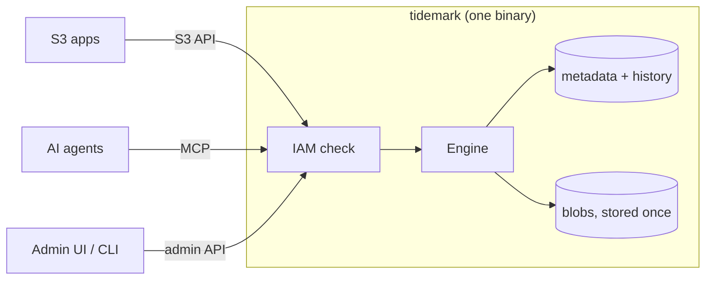

# Tidemark

[](https://github.com/solutionforest/tidemark/actions/workflows/ci.yml)
[](https://github.com/solutionforest/tidemark/actions/workflows/security.yml)
[](https://github.com/solutionforest/tidemark/releases)
[](LICENSE)

**Lightweight, self-hosted, S3-compatible object storage in Rust.** One static binary, one data
directory, no external services. For a NAS, a VPS, a Raspberry Pi or a small team's backup target.

- **Undo mistakes.** Deleted or overwritten objects and buckets go to a trash you can restore from (30 days by default).
- **Time travel.** Read or restore any bucket as it was at any moment in that window.
- **Store once.** Identical content uses disk once; copies and restores are free.
- **Built-in MCP.** AI agents use the same storage under the same access rules.

> **Alpha (`v0.1.0-alpha.3`).** Expect rough edges. Keep a separate backup. Formerly **Cairn**.

## Quick start

```sh
git clone https://github.com/solutionforest/tidemark && cd tidemark
scripts/start.sh --ui
```


This downloads the release binary (checksum verified), creates `./tidemark-data` with random root
keys, and starts S3 on `127.0.0.1:9000` and the admin UI on `127.0.0.1:9080`. Ctrl-C stops it.

```sh
source tidemark-data/credentials.env
aws s3 mb s3://photos
aws s3 cp ./cat.jpg s3://photos/
aws s3 rm s3://photos/cat.jpg                          # oops
./tidemark admin trash restore --bucket photos --key cat.jpg   # back
```

**Connect any S3 app** (rclone, restic, Cyberduck, Nextcloud, Immich, Velero…): endpoint
`http://127.0.0.1:9000`, region `us-east-1`, path-style, keys from `credentials.env`.

## Admin UI


Status, buckets, users, keys and trash with one-click restore. One HTML page plus a one-file
Python or PHP backend that keeps your keys out of the browser. Local machine only. To run it by hand:

```sh
export TIDEMARK_ENDPOINT=http://127.0.0.1:9000 TIDEMARK_ACCESS_KEY=... TIDEMARK_SECRET_KEY=...
python3 admin-ui/server.py        # or: php -S 127.0.0.1:9080 admin-ui/server.php
```

## Docker Compose

```sh
printf 'TIDEMARK_ROOT_ACCESS_KEY=%s\nTIDEMARK_ROOT_SECRET=%s\n' \
  "$(openssl rand -hex 10)" "$(openssl rand -base64 30)" > .env && chmod 600 .env
docker compose up -d                 # S3 on 127.0.0.1:9000
docker compose --profile ui up -d    # plus admin UI on 127.0.0.1:9080
```

Image: `ghcr.io/solutionforest/tidemark` (amd64, arm64). Runs read-only as non-root; data lives in
the `tidemark-data` volume.

## Linux binary

```sh
v=v0.1.0-alpha.3; t=$(uname -m)-unknown-linux-musl
base=https://github.com/solutionforest/tidemark/releases/download/$v
curl -fLO "$base/tidemark-$v-$t.tar.gz" -fLO "$base/SHA256SUMS"
grep " tidemark-$v-$t.tar.gz\$" SHA256SUMS | sha256sum -c - && tar xzf "tidemark-$v-$t.tar.gz"
./tidemark-$v-$t/tidemark init --data-dir ./tidemark-data
./tidemark-$v-$t/tidemark serve --config ./tidemark-data/tidemark.toml
```

For boot-time start use [`deploy/tidemark.service`](deploy/tidemark.service). Put TLS and a
firewall in front before exposing it to a network.

## How it works



Every write is a new version, even without S3 versioning, so anything can be restored within
the retention window.

## Why Tidemark

| | RustFS | VaultS3 | Garage | **Tidemark** |
|---|---|---|---|---|
| Undo an unplanned delete | no | only if versioning was on | no | **yes, every bucket** |
| Read a bucket at time T | no | prior snapshot only | no | **any T in the window** |
| Identical bytes stored once | no | no | no | **yes** |
| MCP with the same IAM rules | separate server | no | no | **built in** |

Idle memory under 25 MiB, binary under 20 MB. Passes 322 of 370 ceph `s3-tests` run (87%).
Single-node by design: no clustering, erasure coding, OIDC or built-in file browser. Need those?
Try [VaultS3](https://github.com/Kodiqa-Solutions/VaultS3), [RustFS](https://github.com/rustfs/rustfs)
or [Garage](https://garagehq.deuxfleurs.fr/).

## Docs

[Operations](docs/OPERATIONS.md) (backup, upgrade, recovery) ·
[Config](docs/CONFIG.md) · [S3 compatibility](docs/COMPAT.md) · [Extensions](docs/EXTENSIONS.md) ·
[MCP](docs/MCP.md) · [Design](docs/DESIGN.md) · [Changelog](CHANGELOG.md)

## Contributing

Issues only, no pull requests. [Open an issue](https://github.com/solutionforest/tidemark/issues/new/choose);
our AI agent reproduces and fixes it, a maintainer reviews. Details in [CONTRIBUTING.md](CONTRIBUTING.md).
Security reports go private: [SECURITY.md](SECURITY.md).

No telemetry, no account, no licence key, no CLA.

## Licence

[AGPL-3.0-only](LICENSE). Self-hosting, even commercially, has no obligations beyond the notice.
If you modify Tidemark and offer it to others over a network, you must share your changes.
