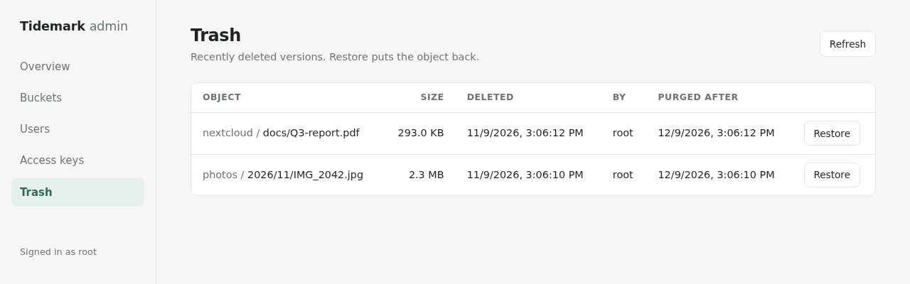
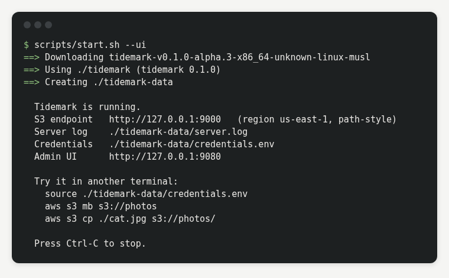
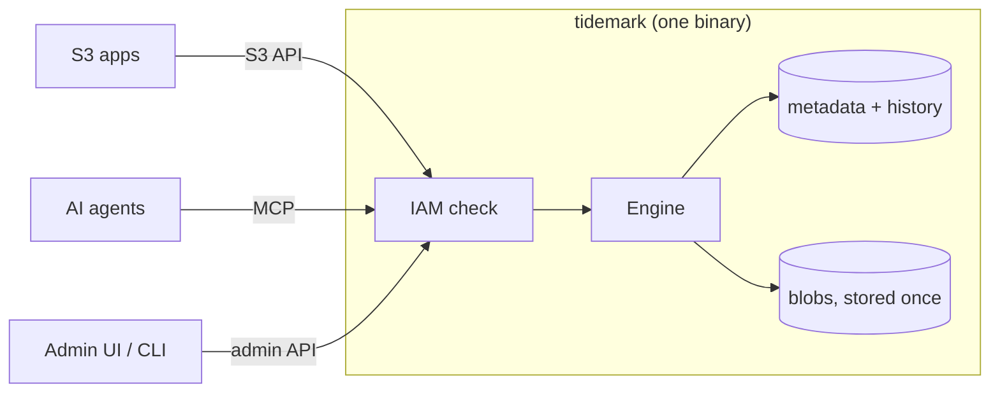

<h1 align="center">Tidemark</h1>

<p align="center">
  <strong>Self-hosted S3-compatible object storage in Rust, with undo built in.</strong><br>
  One static binary, one data directory, no external services.
</p>

<p align="center">
  <a href="https://github.com/solutionforest/tidemark/actions/workflows/ci.yml"></a>
  <a href="https://github.com/solutionforest/tidemark/actions/workflows/security.yml"></a>
  <a href="https://github.com/solutionforest/tidemark/releases"></a>
  <a href="LICENSE"></a>
  
</p>

<p align="center">
  <a href="#quick-start">Quick start</a> &middot;
  <a href="#features">Features</a> &middot;
  <a href="#maturity">Maturity</a> &middot;
  <a href="docs/COMPAT.md">S3 compatibility</a> &middot;
  <a href="docs/OPERATIONS.md">Operations</a> &middot;
  <a href="docs/MCP.md">MCP</a>
</p>

<p align="center">
  
</p>

> [!WARNING]
> **Alpha (`v0.1.0-alpha.3`).** Single node, tested but young. Keep an independent backup.
> Formerly named **Cairn**.

## Why Tidemark

Most self-hosted object stores lose a deleted object for good unless you turned versioning on
beforehand. Tidemark keeps history for every bucket, always:

- **Undo mistakes.** Deleted or overwritten objects, and whole buckets, go to a trash you restore from (30 days by default).
- **Time travel.** Read or restore any bucket as it was at any instant in that window. No snapshot needed.
- **Store once.** Identical content is written to disk once; copies and restores cost no space.
- **Built-in MCP.** AI agents use the same storage under the same IAM rules as everyone else.
- **Small.** 14.6 MiB static binary, about 10 MiB idle memory on Linux ([measured in CI](docs/OPERATIONS.md#footprint)).

## Quick start

```sh
git clone https://github.com/solutionforest/tidemark && cd tidemark
scripts/start.sh --ui
```



This downloads the release binary (checksum verified), creates `./tidemark-data` with random root
keys, and serves S3 on `127.0.0.1:9000` and the admin UI on `127.0.0.1:9080`. Ctrl-C stops it.

```sh
source tidemark-data/credentials.env
aws s3 mb s3://photos
aws s3 cp ./cat.jpg s3://photos/
aws s3 rm s3://photos/cat.jpg                                  # oops
./tidemark admin trash restore --bucket photos --key cat.jpg   # back, byte-identical
```

**Connect any S3 app** (rclone, restic, Cyberduck, Nextcloud, Immich, Velero…): endpoint
`http://127.0.0.1:9000`, region `us-east-1`, path-style, keys from `credentials.env`.

<details>
<summary><b>Docker Compose</b></summary>

```sh
printf 'TIDEMARK_ROOT_ACCESS_KEY=%s\nTIDEMARK_ROOT_SECRET=%s\n' \
  "$(openssl rand -hex 10)" "$(openssl rand -base64 30)" > .env && chmod 600 .env
docker compose up -d                 # S3 on 127.0.0.1:9000
docker compose --profile ui up -d    # plus admin UI on 127.0.0.1:9080
```

Image `ghcr.io/solutionforest/tidemark` (amd64, arm64) runs read-only as non-root; data lives in
the `tidemark-data` volume.
</details>

<details>
<summary><b>Plain Linux binary</b></summary>

```sh
v=v0.1.0-alpha.3; t=$(uname -m)-unknown-linux-musl
base=https://github.com/solutionforest/tidemark/releases/download/$v
curl -fLO "$base/tidemark-$v-$t.tar.gz" -fLO "$base/SHA256SUMS"
grep " tidemark-$v-$t.tar.gz\$" SHA256SUMS | sha256sum -c - && tar xzf "tidemark-$v-$t.tar.gz"
./tidemark-$v-$t/tidemark init --data-dir ./tidemark-data
./tidemark-$v-$t/tidemark serve --config ./tidemark-data/tidemark.toml
```

Start at boot with [`deploy/tidemark.service`](deploy/tidemark.service). Put TLS and a firewall in
front before exposing it to a network.
</details>

<details>
<summary><b>Admin UI by hand</b></summary>

One HTML page plus a one-file Python or PHP backend that keeps your keys out of the browser.
Local machine only.

```sh
export TIDEMARK_ENDPOINT=http://127.0.0.1:9000 TIDEMARK_ACCESS_KEY=... TIDEMARK_SECRET_KEY=...
python3 admin-ui/server.py        # or: php -S 127.0.0.1:9080 admin-ui/server.php
```
</details>

## Features

| | |
|---|---|
| **S3 API** | Buckets, objects, versioning, multipart, CopyObject, ListObjects v1/v2/versions, tagging, Range and conditional requests, 5 checksum algorithms, presigned URLs, lifecycle expiration. [Operation list](docs/COMPAT.md) |
| **Recovery** | Trash for objects, versions and buckets; point-in-time reads (`x-tidemark-as-of`) and bucket restore. [Guide](docs/OPERATIONS.md) |
| **Access control** | IAM users, keys and policies, bucket policies, PublicAccessBlock, SigV4. [Actions](docs/EXTENSIONS.md#iam-actions-tidemark) |
| **Encryption** | SSE-S3 (`AES256`) and bucket default encryption, master key sealed at rest. [Config](docs/CONFIG.md) |
| **Malware scanning** | Uploads are streamed to ClamAV or your own HTTP endpoint before they are stored; infected files land in a quarantine bucket. [Guide](docs/OPERATIONS.md#malware-scanning) |
| **AI agents** | MCP over stdio or HTTP; every tool call is an IAM-checked request. [Guide](docs/MCP.md) |
| **Operations** | Backup and restore, `fsck` and scrub, disk-full handling, Prometheus metrics, health endpoints. [Guide](docs/OPERATIONS.md) |



## Maturity

| Area | State | Evidence |
|---|---|---|
| S3 API, single node | 🟡 Alpha | 322 of 370 ceph `s3-tests` (87%) gate every push; aws-cli, rclone, mc and aws-sdk-s3 tested |
| Trash, time travel, dedupe | 🟡 Alpha | Integration tests; restores checked byte-identical |
| Upgrades | 🟡 Alpha | Data from `0.1.0-alpha.3` on opens in every later release; CI checks it |
| Security | 🟡 Alpha | [Self-review of the auth code](docs/SECURITY-REVIEW-2026-11-10.md) (5 fixes, each with a test), nightly fuzzing, `cargo audit` and `cargo deny` in CI; no external audit yet |
| Crash safety | 🟡 Alpha | `kill -9` mid-write tests, weekly 2 h [soak](docs/OPERATIONS.md#soak) with a kill every 10 min and a disk-full window, `fsck` clean after; 24 h soak in progress |
| Performance | 🟡 Alpha | [Measured](docs/OPERATIONS.md#throughput) on 4 vCPU cloud disk: ~2 100 small PUT/s, ~5 000 small GET/s, 200–1 100 MiB/s large objects |
| Malware scanning | 🧪 New | ClamAV + EICAR tested end to end; not in a release yet |
| Clustering, erasure coding, replication, OIDC, Object Lock | ⛔ Not in v0.1 | Single node by design |

**Road to stable:** `beta.1` after the 24 h soak passes; from then on the data format is frozen
and every upgrade is tested. `v0.1.0` after two betas at least two weeks apart with no
data-affecting bug open. Full checklist: [PRODUCTION-READINESS.md](docs/PRODUCTION-READINESS.md).

### When to pick something else

| | RustFS | VaultS3 | Garage | **Tidemark** |
|---|---|---|---|---|
| Undo an unplanned delete | no | only if versioning was on | no | **yes, every bucket** |
| Read a bucket at time T | no | prior snapshot only | no | **any T in the window** |
| Identical bytes stored once | no | no | no | **yes** |
| MCP with the same IAM rules | separate server | no | no | **built in** |
| Clustering / erasure coding | yes | yes | replication | no |
| Built-in file browser | yes | yes | no | no (use any S3 app) |

Need several nodes, a file browser or OIDC today? Use [VaultS3](https://github.com/Kodiqa-Solutions/VaultS3),
[RustFS](https://github.com/rustfs/rustfs) or [Garage](https://garagehq.deuxfleurs.fr/).

### Getting your data out

Nothing locks you in: it is plain S3. `rclone sync` or `aws s3 sync` to any other S3 store while
Tidemark keeps serving reads. Every release stays AGPL, forkable and buildable.

## Docs

| | | |
|---|---|---|
| [Operations](docs/OPERATIONS.md) | [Config](docs/CONFIG.md) | [S3 compatibility](docs/COMPAT.md) |
| [MCP](docs/MCP.md) | [Extensions](docs/EXTENSIONS.md) | [Design](docs/DESIGN.md) |
| [Readiness](docs/PRODUCTION-READINESS.md) | [Changelog](CHANGELOG.md) | [Security](SECURITY.md) |

## Contributing

Issues only, no pull requests. [Open an issue](https://github.com/solutionforest/tidemark/issues/new/choose);
our AI agent reproduces and fixes it, a maintainer reviews. Details in [CONTRIBUTING.md](CONTRIBUTING.md).
Security reports go private: [SECURITY.md](SECURITY.md).

No telemetry, no account, no licence key, no CLA.

## Licence

[AGPL-3.0-only](LICENSE). Self-hosting, even commercially, has no obligations beyond the notice.
If you modify Tidemark and offer it to others over a network, you must share your changes.
