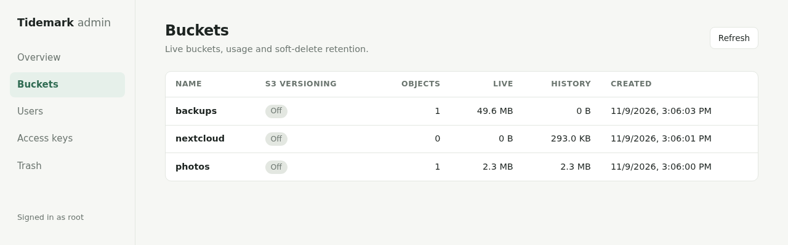
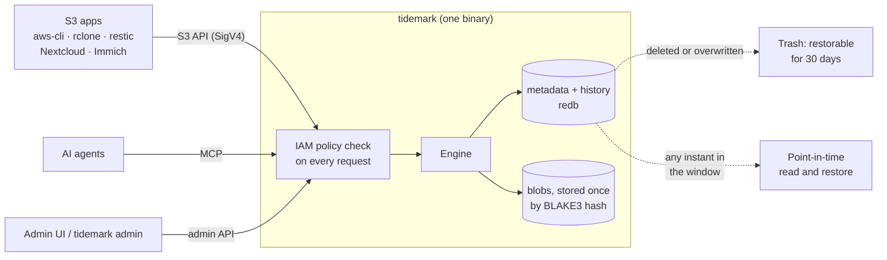
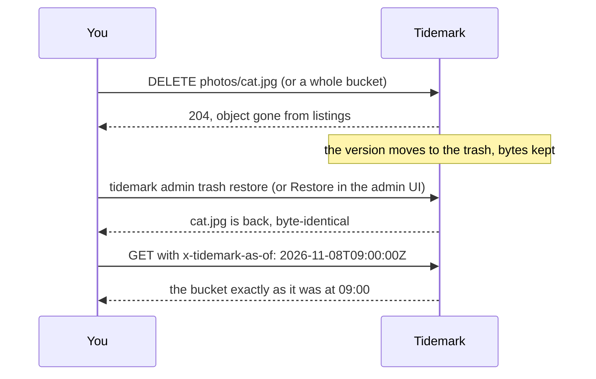

# Tidemark

[](https://github.com/solutionforest/tidemark/actions/workflows/ci.yml)
[](https://github.com/solutionforest/tidemark/actions/workflows/security.yml)
[](https://github.com/solutionforest/tidemark/releases)
[](LICENSE)

**Lightweight, self-hosted, S3-compatible object storage in Rust.** One static binary, one data
directory, no external services. Built for people who run one box (or a few): a NAS, a VPS, a
Raspberry Pi, a homelab, a small team's backup target.

Tidemark makes four promises that other S3 servers do not:

1. **Recover from accidental changes.** Every bucket keeps history internally ("shadow
   versioning"), so deleted objects and buckets can be restored within the retention window.
   This does not replace an independent backup.
2. **Any bucket is readable and restorable as of any instant** in its retention window
   (`x-tidemark-as-of`, `tidemark pitr`). No snapshot to have taken first.
3. **Identical content costs disk once.** Blobs are content-addressed; copies and restores write
   no new bytes.
4. **AI agents get the same storage under the same rules.** The MCP server is in the binary and
   every tool call is an IAM policy decision, not a root token.

On top: IAM-style policies and STS, SigV4, encryption at rest, lifecycle, fsck/scrub/backup,
metrics and audit logs. That is the whole list, on purpose.

Tidemark is single-node by design and deliberately narrow. If you want a dashboard, erasure coding,
clustering, OIDC, search or FUSE in one AGPL binary, [VaultS3](https://github.com/Kodiqa-Solutions/VaultS3)
already does that well. If you need a distributed cluster, use [RustFS](https://github.com/rustfs/rustfs)
or [Garage](https://garagehq.deuxfleurs.fr/).

> Formerly **Cairn** (renamed in `v0.1.0-alpha.3`; old GitHub links redirect).

> **Status: alpha (`v0.1.0-alpha.3`).** Expect bugs and S3 compatibility gaps; do not rely on
> Tidemark as your only copy of important data. Back up and test restoration. On-disk formats may
> change before 0.1.0; see [`docs/OPERATIONS.md`](docs/OPERATIONS.md) before upgrading.

## Start in one command

```sh
git clone https://github.com/solutionforest/tidemark && cd tidemark
scripts/start.sh --ui
```


The script finds a `tidemark` binary (or downloads the release for your Linux x86-64/ARM64 machine
and checks its SHA-256), creates `./tidemark-data` with fresh random root credentials, starts the
S3 server on `127.0.0.1:9000` and, with `--ui`, the admin page on `127.0.0.1:9080`. Ctrl-C stops
both; run it again and it picks up the same data. Credentials are saved to
`./tidemark-data/credentials.env` (readable only by you), so another terminal is one line away:

```sh
source tidemark-data/credentials.env     # sets AWS_* and TIDEMARK_* for aws-cli, rclone and `tidemark admin`
aws s3 mb s3://photos
aws s3 cp ./cat.jpg s3://photos/
aws s3 rm s3://photos/cat.jpg         # oops
./tidemark admin trash ls                # still there
./tidemark admin trash restore --bucket photos --key cat.jpg
```

Options: `--data-dir`, `--port`, `--ui-port`, `--version`; `TIDEMARK_BIN=/path/to/tidemark` uses your
own build. The script is for trying Tidemark and for single-user boxes. For a server that starts on
boot, use [systemd](#run-it-as-a-service) or [Docker Compose](#docker-compose), and delete `credentials.env` once
the credentials are in your password manager.

### Connect your apps

Anything that speaks S3 works: endpoint `http://127.0.0.1:9000`, region `us-east-1`,
path-style addressing, and the keys from `credentials.env`. For example rclone
(`rclone config create tidemark s3 provider Other endpoint http://127.0.0.1:9000 env_auth true`),
Cyberduck, restic (`restic -r s3:http://127.0.0.1:9000/backups init`), Nextcloud, Immich, Velero
or Loki. Per-client notes are in [`docs/COMPAT.md`](docs/COMPAT.md). The listener is local to this
machine; put TLS and a firewall in front before you open it to a network.

### Admin UI




[`admin-ui/`](admin-ui/) shows server status, buckets, users, access keys and the trash, and
restores deleted objects in one click. It is deliberately small: one HTML page with plain
JavaScript, plus a backend in one file that holds your keys and signs requests, so the browser
never sees them. `start.sh --ui` runs it for you; to run it by hand against any Tidemark server:

```sh
export TIDEMARK_ENDPOINT=http://127.0.0.1:9000 TIDEMARK_ACCESS_KEY='<key>' TIDEMARK_SECRET_KEY='<secret>'
python3 admin-ui/server.py                    # Python 3.8+, no packages
php -S 127.0.0.1:9080 admin-ui/server.php     # or PHP 8+
```

Both backends accept connections from this machine only and have no login of their own; do not
put them behind a public proxy. Browsing and uploading files is left to the S3 clients above,
which already do it well.

## How it works



Every write records a new version, whether or not the bucket has S3 versioning on, so deletes and
overwrites are recoverable for the retention window (`[retention]` in the config, 30 days by
default). Object bytes are stored once per unique content, which is why history, copies and
restores cost almost no extra disk. Everything lives in one data directory:

```text
tidemark-data/
├── tidemark.toml          configuration (every key: deploy/tidemark.example.toml)
├── meta/               buckets, versions, users, policies (one redb file)
├── blobs/              object bytes, content-addressed, optionally encrypted
├── keys/master.key     encryption master key; back it up separately
└── audit/              audit log
```

Undo after a mistake:



## Other ways to run it

### Linux binary

Download the archive for your CPU from the
[release page](https://github.com/solutionforest/tidemark/releases/tag/v0.1.0-alpha.3), or:

```sh
v=v0.1.0-alpha.3
t=$(uname -m)-unknown-linux-musl          # x86_64 or aarch64
base=https://github.com/solutionforest/tidemark/releases/download/$v
curl -fLO "$base/tidemark-$v-$t.tar.gz" -fLO "$base/SHA256SUMS"
grep " tidemark-$v-$t.tar.gz\$" SHA256SUMS | sha256sum -c -
tar xzf "tidemark-$v-$t.tar.gz"
./tidemark-$v-$t/tidemark init --data-dir ./tidemark-data
./tidemark-$v-$t/tidemark serve --config ./tidemark-data/tidemark.toml
```

`init` prints the root access key and secret once; save them securely. The binary is static, so
it runs on any Linux without extra libraries.

### Docker Compose

```sh
git clone https://github.com/solutionforest/tidemark && cd tidemark
printf 'TIDEMARK_ROOT_ACCESS_KEY=%s\nTIDEMARK_ROOT_SECRET=%s\n' \
  "$(openssl rand -hex 10)" "$(openssl rand -base64 30)" > .env && chmod 600 .env
docker compose up -d                  # S3 on http://127.0.0.1:9000
docker compose --profile ui up -d     # optional: plus the admin UI on http://127.0.0.1:9080
```

[`compose.yaml`](compose.yaml) runs the published image read-only, as a non-root user with no
capabilities, and keeps data in the `tidemark-data` volume. `.env` holds your root credentials
(`source .env` gives you `TIDEMARK_ROOT_*`; aws-cli and rclone want them as `AWS_ACCESS_KEY_ID` and
`AWS_SECRET_ACCESS_KEY`). Tidemark reads them only on the first start, when it seals them into its
credential store. The image is public on GHCR (`linux/amd64` and `linux/arm64`, no login);
`docker compose up -d --build` builds it from the checkout instead (a full Rust build, several minutes). Both ports listen on `127.0.0.1` only; set
`TIDEMARK_PORT` or `TIDEMARK_UI_PORT` in `.env` to move them. Open the admin UI as `127.0.0.1`, not
`localhost`: it refuses other host names. `docker compose down` stops the stack and keeps the data;
`docker compose down -v` deletes it.

Without compose:

```sh
docker run -d --name tidemark --restart unless-stopped \
  -p 127.0.0.1:9000:9000 -v tidemark-data:/data --env-file .env \
  ghcr.io/solutionforest/tidemark:0.1.0-alpha.3
```

### Run it as a service

[`deploy/tidemark.service`](deploy/tidemark.service) is a hardened systemd unit. Configuration: every key
with its default is in [`deploy/tidemark.example.toml`](deploy/tidemark.example.toml), and any key can be
set from the environment as `TIDEMARK_<SECTION>_<KEY>`. Backup, restore, upgrade and disaster recovery
are in [`docs/OPERATIONS.md`](docs/OPERATIONS.md).

## Compared with the alternatives

Same rows and columns as [`docs/DESIGN.md`](docs/DESIGN.md) §0. Competitor cells come from each
project's own documentation. Tidemark cells say only what is true in `main` today and name the test that
proves it (rows in [`docs/PRODUCTION-READINESS.md`](docs/PRODUCTION-READINESS.md)).

| | RustFS | VaultS3 | Garage | **Tidemark** (today) |
|---|---|---|---|---|
| Shape | distributed cluster, Apache-2.0, Rust | single binary, AGPL, Go, 100+ features incl. dashboard, EC, Raft, OIDC, search | small replicated store, AGPL, Rust | single binary, AGPL, Rust |
| Versioning | per-bucket opt-in | per-bucket opt-in; snapshots are an explicit commit | none | always on internally (engine; every write is a new version) |
| Undo after a delete you did not plan for | no | only if versioning was already on | no | **yes, every bucket, zero setup**: overwrite + delete object + delete bucket, then `tidemark admin trash restore` returns every version byte-identical (`crates/tidemark-server/tests/undo.rs`) |
| Read a bucket as it was at time T | no | snapshot you took earlier | no | **any T in the retention window**, no prior snapshot: `x-tidemark-as-of` reads and PITR restore, including to before a bucket delete (`crates/tidemark-server/tests/pitr.rs`) |
| Identical bytes stored once | no | no | no | **yes (BLAKE3 content addressing)**: N identical uploads, copy, trash restore and PITR restore add zero blob bytes, encrypted or not (`crates/tidemark-server/tests/dedup.rs`) |
| MCP for agents | separate server, plain S3 creds | none | none | **in-process, same IAM policies**: a key denied to S3 is denied to MCP `get_object` over HTTP and stdio; `as_of` needs `tidemark:TimeTravel` (`crates/tidemark-server/tests/auth_wire.rs`, `crates/tidemark-cli/tests/mcp_stdio.rs`) |

Tidemark is deliberately narrow: no built-in dashboard, erasure coding, clustering, replication, OIDC, search,
FUSE or S3 Select in v0.1 (DESIGN §0 "Shelved"). Idle memory, binary size and 10 GiB-transfer RSS
are produced by [`scripts/footprint.sh`](scripts/footprint.sh); method and caveats in
[`docs/OPERATIONS.md`](docs/OPERATIONS.md#footprint):

| Footprint (static musl release build, 2026-11-08/09) | Tidemark | v0.1 target |
|---|---|---|
| Idle RSS after a 110 s settle | 10.4 MiB (Linux 7.0, aarch64, CI `footprint` job) | ≤ 25 MiB |
| Peak RSS during a 10 GiB upload + download | 58.3 MiB | < 256 MiB |
| Static binary size | 17.3 MiB x86_64, 13.7 MiB aarch64 | ≤ 20 MB |

VaultS3 publishes 17 MiB idle on its own hardware; we do not quote other projects' numbers as if
they were measured on ours. If a cell about Tidemark is wrong, open an issue; the table is part of
the definition of done.

## Promises

These are commitments, not aspirations, and they are in git:

- **No telemetry.** The server never phones home.
- **No account.** Nothing to sign up for, ever, to download, run or update Tidemark.
- **No licence key.** The binary you build or download is the whole product.
- **Nothing in the core moves behind a paid tier.** If it is in the binary, it stays in the binary.
- **No CLA.** Contributions are DCO-signed ([`CONTRIBUTING.md`](CONTRIBUTING.md)), so no single
  party, including the maintainers, can relicense the core.
- Every security fix gets a public advisory ([`SECURITY.md`](SECURITY.md)).

## S3 compatibility

Tidemark targets drop-in compatibility with the AWS SDKs, `aws` CLI, `rclone`, `restic`, `mc`,
and the long tail of S3-backed apps (Nextcloud, Immich, Velero, Loki, Terraform state, …). The
per-operation status, known differences and client test results are tracked in
[`docs/COMPAT.md`](docs/COMPAT.md), Tidemark-specific
headers and actions in [`docs/EXTENSIONS.md`](docs/EXTENSIONS.md), and every push runs the ceph
`s3-tests` suite and fails if any test in the committed
[`scripts/s3-tests/expected-pass.txt`](scripts/s3-tests/expected-pass.txt) regresses. The latest
recorded development run passed 322 of 370 executed tests (87.0%); 53 ACL-grant tests were
excluded, giving 322 of 423 (76.1%) when counted. This measures a selected suite, not complete
S3 compatibility or code coverage, and is not a test result for the earlier alpha binary.

## Licence

Tidemark is licensed under the **GNU Affero General Public License v3.0 only**
([`LICENSE`](LICENSE)).

- **Self-hosting for yourself or your organisation** (including commercially, internally, or as
  the storage behind your product): no obligations beyond the licence notice. Using Tidemark
  through its S3 API does not make your application a derivative work.
- **Modifying Tidemark and letting others use it over a network** (for example offering it as a
  hosted storage service, or running a patched version for customers): you must offer those
  users the complete corresponding source of your modified Tidemark under the AGPL.
- **Redistributing binaries or images**: ship or link the corresponding source, keep the
  licence and notices.

This is not legal advice. Commercial licensing for cases the AGPL does not fit may be offered by
the maintainers later; ask via an issue.

## Security

Please report vulnerabilities privately; see [`SECURITY.md`](SECURITY.md) (GitHub security
advisories or `security@solutionforest.net`, 90-day coordinated disclosure). Release binaries
embed their dependency list for `cargo audit bin`, and ship with a CycloneDX SBOM and SHA256SUMS.

## Contributing: issues, not pull requests

Tidemark takes contributions as **issues**. We do not accept pull requests for now: opening one is
limited to maintainers, and any that get through are closed automatically with a pointer here. Open an
[issue](https://github.com/solutionforest/tidemark/issues/new/choose) instead:

- **Bug**: version (`tidemark --version`), how you run it, the client and the exact command or
  request, what you expected, what happened, and the log lines around it (redact keys).
- **S3 incompatibility**: the client, the operation, and the AWS behaviour you expected. Check
  [`docs/COMPAT.md`](docs/COMPAT.md) first; documented deviations are listed there.
- **Feature request**: the problem you have, not only the solution. Scope is narrow on purpose
  ([`docs/DESIGN.md`](docs/DESIGN.md) §0), so some requests will be declined with a reason.

The maintainers' AI agent triages each issue, reproduces it, writes the fix with a regression
test, and a maintainer reviews it before it lands. The issue is linked from the fix commit and
closed when it ships. Security problems go through [`SECURITY.md`](SECURITY.md), never a public
issue. More in [`CONTRIBUTING.md`](CONTRIBUTING.md); architecture and build conventions are in
[`docs/DESIGN.md`](docs/DESIGN.md) and [`AGENTS.md`](AGENTS.md); changes are in
[`CHANGELOG.md`](CHANGELOG.md).
