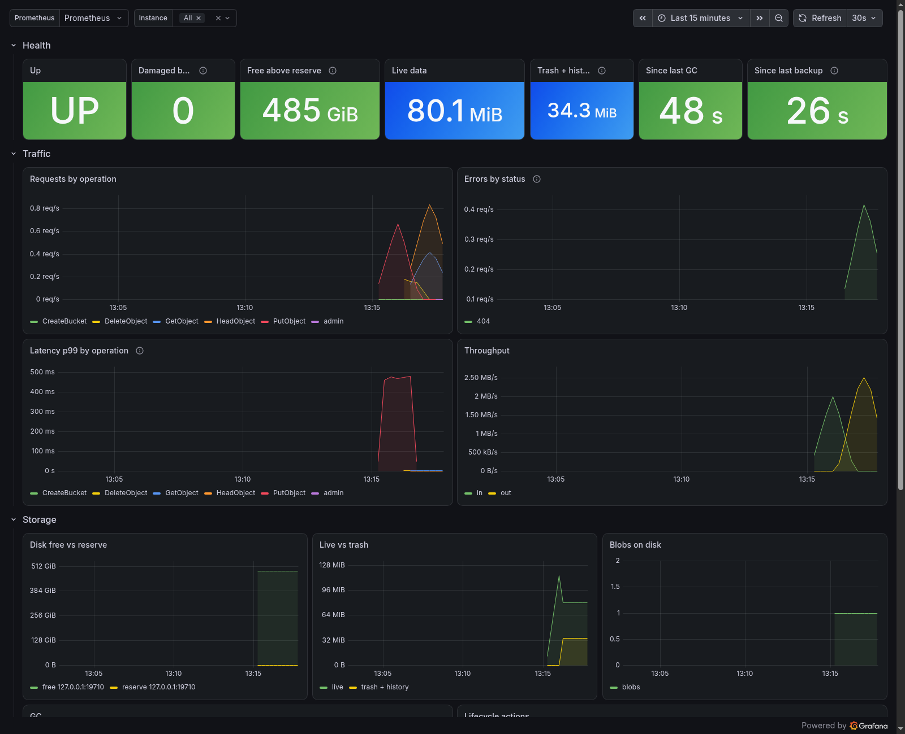

# Tidemark — Operations guide

Sections are owned by the agent that wrote them; append new sections, do not rewrite others.

## Footprint

Run 2026-11-08T19:14Z by `scripts/footprint.sh`: tidemark 0.1.0 @ f922680 plus the size-optimised
release profile (`opt-level = "z"`, fat LTO, one codegen unit, stripped), `cargo build --release
--target x86_64-unknown-linux-musl`, x86_64 gVisor sandbox reporting 1 vCPU. RSS is the process
VmRSS from `/proc` (not a container working set; this sandbox exposes no VmHWM, so the peak is
the max of 0.2 s samples and a shorter spike could be missed).

| Measure | Value |
|---|---|
| Binary size | 18192904 bytes (17.3 MiB), static |
| RSS at ready | 29.7 MiB |
| Idle RSS after 110 s | 29.6 MiB |
| Peak RSS (max of 0.2 s VmRSS samples; VmHWM unavailable), 10240 MiB upload + download | 58.3 MiB |
| Max sampled RSS (0.2 s interval) during transfer | 58.3 MiB |
| Upload / download wall time | 34 s / 51 s |
| Round-trip sha256 | match |

**Why idle RSS on this host is not the E2 number.** gVisor keeps the whole executable resident
(the 17.3 MiB binary shows up in full in `/proc/<pid>/smaps`; a regular kernel pages in only
what runs) and faults anonymous memory in coarse chunks: five fresh starts of the same binary
measured 25.4–34.3 MiB, with the binary mapping constant at 17.4 MiB and anonymous memory
varying between 6 and 16 MiB from the first second on. The E2 budget is therefore checked on a
regular Linux kernel by `.github/workflows/footprint.yml` (GitHub-hosted runner, size + idle,
fails over budget); the step summary of the latest run is the number to quote.

Regular-kernel run 2026-11-09T04:15Z (CI `footprint` job, run 42560176403): tidemark 0.1.0 @ eb04188,
release build, aarch64-unknown-linux-musl, 4 vCPU, Linux 7.0.14. Binary 14379056 bytes
(13.7 MiB, static; the x86_64 build is 17.3 MiB), RSS 10.3 MiB at ready, **10.4 MiB idle after
110 s**.

Since 2026-11-09 the release binary no longer contains the AWS SDK or the OIDC libraries
(DECISIONS "Shelved features leave the release binary"): x86_64 is 15323528 bytes (14.6 MiB).
The tables above predate that; the CI `footprint` job re-measures size and idle RSS on every push.

**Size profile cost.** Server CPU per GiB, measured with `aws s3 cp` on this host for opt-level
3 / `s` / `z`: put 2.6 / 2.4–2.6 / 2.5–2.6 s, get 4.9–5.3 / 5.5 / 5.2 s, i.e. inside run-to-run
noise. Hashing (BLAKE3, SHA-2, CRC) runs on SIMD/assembly paths whatever the opt-level.

Against the v0.1 limits (PRODUCTION-READINESS E1, E2): the 10 GiB round trip stays far under
256 MiB, so uploads and downloads stream; the binary is under 20 MB. Re-measure with
`scripts/footprint.sh target/x86_64-unknown-linux-musl/release/tidemark`; set
`FOOTPRINT_MAX_BINARY_BYTES` / `FOOTPRINT_MAX_IDLE_MIB` / `FOOTPRINT_MAX_PEAK_MIB` to make it
fail over budget.

## Upgrades

**Promise.** A data directory or backup written by `v0.1.0-alpha.3` or any later release opens
in every later release; install the new binary and start it. Every push tests this against
every published release (`scripts/upgrade-test.sh`, DESIGN §4.5). Directories from
`0.1.0-alpha.1`/`alpha.2` (Cairn) are not covered; see the alpha.3 changelog entry.

Tidemark keeps its metadata (buckets, versions, IAM, sessions, outbox) in one redb file,
`<data_dir>/meta/tidemark.redb`. Blobs are content-addressed and never change format in place, so an
upgrade is a metadata-schema question only.

**Schema version.** The version is a big-endian `u32` in the `kv` table under the key
`schema_version` (`tidemark_meta::migrate::CURRENT_SCHEMA`, currently **1**). Every record also
carries a leading schema byte, so a migration can rewrite records lazily or in bulk.

**What happens on start.** Before the server opens the store it runs
`tidemark_meta::migrate::migrate(<db>, dry_run = false)`:

1. A brand-new, empty database is stamped with the current version. A database with data but no
   stamp (written before the framework existed) is treated as v1.
2. A database **newer** than the binary (`schema_version > CURRENT_SCHEMA`) is refused with
   `metadata schema vN is newer than this binary supports`. Nothing is written. Downgrade by
   restoring the pre-upgrade backup (below) with the old binary.
3. If steps are needed, the redb file is first copied to `<db>.pre-v<N>.bak` (N = target
   version) and fsynced. Only then are the registered steps applied, each in its own write
   transaction together with the version bump, so a crash leaves the file at a well-defined
   version and re-running the upgrade continues from there.
4. A missing step (no registered `vA → vA+1`) aborts with `no migration path` before any write.

**Recommended procedure.**

```sh
tidemark migrate --dry-run --data-dir /srv/tidemark   # prints from/to and the planned steps; writes nothing
systemctl stop tidemark
tidemark backup --data-dir /srv/tidemark ...           # optional extra copy
# install the new binary
systemctl start tidemark                            # runs the migration, writes meta/tidemark.redb.pre-vN.bak
```

Disk space: the pre-upgrade snapshot is a full copy of `tidemark.redb`; keep at least that much free
under `meta/`. Remove old `*.pre-v*.bak` files once the new version has run cleanly.

**Rollback / downgrade.** Stop the server, move `tidemark.redb` aside, rename
`tidemark.redb.pre-vN.bak` to `tidemark.redb`, start the previous binary. Writes made after the upgrade
are lost (blobs they created become orphans that `tidemark fsck --repair` / GC reclaim).

**For developers adding a migration.** Bump `CURRENT_SCHEMA`, append a
`Migration { from, to, name, apply }` to `tidemark_meta::migrate::REGISTRY`. `apply` gets the
`&WriteTxn`, must be deterministic (the writer may re-run it), and should rewrite only what changed.
Add a test that copies `crates/tidemark-meta/tests/fixtures/meta-v1.redb` (the committed v1 fixture)
and migrates it; never edit an existing fixture, add `meta-vN.redb` instead.

## Backup and restore

**A running server backs itself up.** `tidemark backup` opens the metadata database directly,
which a running server holds, so on a live server it refuses with a pointer to the command below.
Set a backup directory and let the server do it:

```toml
[backup]
dir = "/var/backups/tidemark"               # one subdirectory per set
passphrase_file = "/root/tidemark-backup.pass"  # optional; encrypts every set, includes keys/
```

```sh
tidemark admin backup start --set 2026-W46 --wait   # incremental; the first run of a set is full
tidemark admin backup status                        # running / succeeded / failed + report
tidemark backup ls --from /var/backups/tidemark/2026-W46
tidemark restore --from /var/backups/tidemark/2026-W46 --data-dir /srv/tidemark-restored \
                 [--id <manifest>] [--passphrase-file /root/tidemark-backup.pass]
```

`POST /_tidemark/v1/backup` (`tidemark:Backup`) starts one job in the background, 409 while one
runs; `GET /_tidemark/v1/backup` (`tidemark:GetServerInfo`) reports it. Set names are a single
plain directory name, so the API can only write under `backup.dir`. Writes keep being served
while it runs. The server exports `tidemark_backup_last_success_timestamp_seconds` (read back
from the newest manifest at startup) and `tidemark_backup_runs_total{result}`.

**Schedule, rotation, off-site.** [`deploy/backup/`](../deploy/backup/) has an hourly cron job:
it backs up into the current ISO week's set, keeps the newest `KEEP_SETS` weekly sets (pruning
inside a set is not implemented, so whole sets rotate) and mirrors `backup.dir` to any `rclone`
remote. A set only ever gains files and an encrypted set is ciphertext except
`tidemark-backup.json`, so a plain sync is safe. Run it as a dedicated user that may only back
up (`backup-user-policy.json`), not with the root key. To restore from off-site, `rclone sync`
the set back to a local directory first.

**Offline.** With the server stopped, `tidemark backup --data-dir /srv/tidemark --to <dir>
[--passphrase-file f] [--include-keys] [--full]` does the same thing from the CLI. A build with
`--features remote` can also use `--to s3://bucket/prefix --endpoint https://…`
(credentials from `AWS_ACCESS_KEY_ID` / `AWS_SECRET_ACCESS_KEY`).

**What a backup contains.** A backup *set* (a directory) holds `tidemark-backup.json`
(format, KDF salt and parameters, key check), one manifest per backup, one metadata dump per
backup and a shared, content-addressed `blobs/` area. The metadata dump is every table read from
**one redb read transaction**, and the blob list comes from the same snapshot, so a backup is the
state of a single commit even while the server keeps serving traffic. Because blobs are immutable
and named by hash, an incremental backup uploads only blobs that the newest previous manifest does
not list; `--full` uploads everything again. Each manifest lists every blob needed to restore it,
so any manifest restores on its own.

**Encryption.** With a passphrase the whole set is encrypted: argon2id (64 MiB, 3 passes) derives
the set key from the passphrase; each file gets a random salt and a BLAKE3-derived subkey and is
sealed in 64 KiB ChaCha20-Poly1305 chunks with a STREAM nonce (truncation, reordering and tampering
are detected). Manifests and the metadata dump are sealed too; only `tidemark-backup.json` is clear
text. A set is either encrypted or not: use a new destination to change that or the passphrase.
`--include-keys` (only allowed with a passphrase) also saves `<data_dir>/keys/`; without it, keep
`keys/master.key` somewhere safe yourself — blobs encrypted at rest cannot be read without it.

**Restore** refuses a directory that already has `meta/tidemark.redb`. It downloads and verifies every
file (size + BLAKE3 from the manifest; plaintext blobs must also hash to their id), then loads the
metadata dump into a fresh redb file. Start `tidemark serve` on the restored directory as usual; run
`tidemark fsck --verify full` once as a drill.

A blob that GC deletes while a backup is running makes that backup fail with a clear error; run
it again.

## fsck and scrub

```sh
tidemark fsck --data-dir /srv/tidemark [--verify none|sample:1000|full] [--repair] [--json]
tidemark scrub --data-dir /srv/tidemark [--rate 50MiB] [--concurrency 2] [--once]
```

`tidemark fsck` compares metadata and blobs: **orphan blobs** (file without a metadata row, older
than 1 h so in-flight uploads are not flagged), **missing blobs** (referenced, file absent),
**refcount drift** (stored refcount ≠ references counted in versions + multipart uploads),
**corrupt blobs** (BLAKE3 mismatch; `--verify` chooses none / a random sample / all), **dangling
multipart uploads** (bucket gone, index rows missing or orphaned) and **`latest` rows** that are
not the newest live version. It also lists the damage registry (findings of scrub and earlier
runs). Exit status: 0 clean, 1 findings, 2 error.

`--repair` only does safe, reversible things, and is safe on a running server (each fix re-checks
its precondition inside the metadata transaction; rows that changed meanwhile are skipped and
reported):
- refcounts are rewritten to the recounted value (keeping the GC index consistent);
- orphan files are *indexed for GC* (refcount 0) — GC deletes them after its grace period, so an
  orphan that turns out to be needed can still be recovered from disk until then;
- versions whose blobs are missing or corrupt are **flagged damaged**, never deleted: GET/HEAD
  answer `500 InternalError` with `x-tidemark-damaged: true`. Heal them by restoring the blob (from a
  backup) and re-run
  `fsck --repair`, which clears flags of blobs that verify again;
- dangling uploads are aborted and `latest` rows recomputed.

`tidemark scrub` re-hashes referenced blobs in the background in blob-id order, under an IO budget
(`rate` bytes/s, `concurrency` parallel reads), skipping blobs verified within
`reverify_after` (default 30 days). Progress (`scrub/cursor`) and per-blob last-verified times
(`scrub/at/<blob>`) live in the `kv` table, so it resumes after restarts. Corrupt or missing blobs
go to the damage registry and are logged at error level; run `tidemark fsck --repair` to flag the
affected versions. Defaults: 50 MiB/s, 2 concurrent, one pass then sleep 24 h.

```toml
[storage.scrub]
enabled = true
rate = "50MiB"
concurrency = 2
reverify_after = "30d"
idle_between_passes = "24h"
```

## Disk full

Tidemark keeps a free-space **reserve** on the data volume (default 1 GiB, `[storage] min_free`).
Before a PUT, UploadPart, UploadPartCopy, CopyObject or CompleteMultipartUpload writes blob data,
the engine checks `statvfs` on the data directory; if free space minus the declared length would
fall below the reserve, the request fails immediately with **507** (`InsufficientStorage`, with
`Retry-After: 60` and `x-tidemark-storage-full: true`) before any byte is streamed. A write that
still hits `ENOSPC` mid-stream is cleaned up and answered the same way. The reserve leaves room
for metadata commits, so reads, deletes, trash purges, lifecycle and GC keep working and the
server stays up and ready. Response bodies never include disk figures.

To recover: free space (purge trash with `tidemark admin trash purge`, lower retention, run
`tidemark gc` or add capacity), then writes resume automatically. Run `tidemark fsck`
afterwards if the disk filled completely (a crash at ENOSPC can leave orphan blobs, which fsck
indexes for GC). Alert well before the reserve is reached: `tidemark_disk_free_bytes` against
`tidemark_disk_reserve_bytes`, as the `TidemarkDiskNearReserve` and `TidemarkDiskFillingUp` rules in
[`deploy/prometheus/`](../deploy/prometheus/) do.

## Monitoring

[`deploy/`](../deploy/) has a Prometheus scrape job and alert rules, a Grafana dashboard, and the
backup cron job above. `scripts/deploy-kit-test.sh` runs all of it against a real server and a
real Prometheus in CI.



`GET /metrics` is unauthenticated; expose it only to Prometheus. Storage gauges refresh every
`metrics.stats_interval` (default 5 min).

| Alert | Fires when | Severity |
|-------|-----------|----------|
| `TidemarkDown` | the scrape fails for 2 min | critical |
| `TidemarkDiskNearReserve` | free space < 1.5 × the reserve (2 GiB floor with the reserve off) for 10 min | critical |
| `TidemarkDiskFillingUp` | at the 6 h trend, free space reaches the reserve within 24 h | warning |
| `TidemarkStorageFull` | any 507 in 10 min (writes are being refused) | critical |
| `TidemarkDamagedBlobs` | scrub or fsck flagged a blob (`tidemark_damaged_blobs > 0`) | critical |
| `TidemarkTrashLargerThanData` | trash + history > live bytes (and > 1 GiB) for 6 h | warning |
| `TidemarkGcStalled` | no successful GC pass for 1 h | warning |
| `TidemarkHighErrorRate` | > 5% of requests are 5xx for 10 min | warning |
| `TidemarkEventsDeadLettered` | an event sink dead-lettered events in the last hour | warning |
| `TidemarkAuditDropped` | the audit writer fell behind and dropped records | warning |
| `TidemarkBackupStale` | the newest backup in `backup.dir` is older than 2 h | warning |

## Throughput

`scripts/bench.sh` (warp 1.3.0, 60 s per workload, fresh data dir) on GitHub-hosted
`ubuntu-latest`: 4 vCPU, 16 GiB, cloud SSD (not local NVMe), x86_64 musl release build of
tidemark 0.1.0 @ 6f111fd, 2026-11-10. Three runs; two on AMD EPYC 7763, one on EPYC 9V74.
Shown as the range across the three runs.

| Workload | Concurrency | Throughput | ops/s | p50 | p99 |
|---|---|---|---|---|---|
| PUT 4 KiB | 16 | 8.1–9.2 MiB/s | 2 070–2 340 | 6.1–7.5 ms | 13.5–34.4 ms |
| GET 4 KiB | 16 | 19.1–24.8 MiB/s | 4 900–6 360 | 2.4–3.1 ms | 8.1–11.2 ms |
| PUT 64 MiB | 4 | 215–391 MiB/s | 3.4–6.1 | 650–1 230 ms | 980–1 460 ms |
| GET 64 MiB | 4 | 727–1 105 MiB/s | 11.4–17.3 | 231–352 ms | 242–369 ms |
| LIST (10 000 keys, 1 000/page) | 4 | 81 000–109 000 keys/s | – | 92–122 ms | 121–157 ms |

Small PUT is bound by the metadata commit (one fsync per batch) on network-attached disk; local
NVMe should do better, but that has not been measured. Re-run on your own hardware with
`scripts/bench.sh path/to/tidemark` before sizing anything; the targets in DESIGN §13 are these
measured numbers, not hopes.

## Soak

`scripts/soak.sh` runs warp mixed load plus an rclone ledger (files copied in, then checked
byte-for-byte after every restart), `kill -9` at the end of every segment, one disk-full window
(a ballast file brings free space under the reserve), then `fsck --verify full`.

First run 2026-11-10 (soak workflow run 42779819852, GitHub-hosted, 3 × 10 min):

| Segment | Phase | Requests | MiB in / out | 5xx (507) | Ledger batches verified | RSS at kill |
|---|---|---|---|---|---|---|
| 1 | load | 1 141 148 | 42 941 / 213 899 | 0 (0) | 1 | 163.1 MiB |
| 2 | disk-full | 198 | 65 / 24 | 51 (51) | 2 | 32.8 MiB |
| 3 | load | 1 113 713 | 41 915 / 208 756 | 0 (0) | 3 | 180.4 MiB |

`fsck --verify full` clean; max RSS 180.4 MiB (budget 256 MiB); every 5xx was the intended 507
during the disk-full window. The weekly workflow runs 2 h with the same shape.

Long runs 2026-11-10/11 on a single-vCPU gVisor host with a network disk (24 h attempts):

| Run | Build | Segments (`kill -9` each) | Requests | 5xx | Max RSS | Ended | `fsck --verify full` |
|---|---|---|---|---|---|---|---|
| 1 | 7eefa0e | 64 (10.7 h), no disk-full window | 26.4 M | 0 | 170.6 MiB | host restarted overnight | clean (3 640 blobs, 4.0 M versions) |
| 2 | beta.1 | 17 (2.9 h), disk-full at segment 4 | 35.7 M | 58, all 507 in the disk-full window | 916.6 MiB | restart took 120 s, the script's old timeout | clean (936 blobs, 5.4 M versions) |

Two findings, both fixed after beta.1. Restart after a crash checked the whole metadata file
first (120 s under load for the 4 GB file run 2 had built); every commit now records the
allocation state, and the same file restarts in 0.3 s. Memory under sustained heavy load grew
past 1 GiB because the metadata cache defaulted to 1 GiB; `[storage] meta_cache` now caps it
(default: an eighth of RAM or the container limit, 64–256 MiB). A clean 24 h run is still open
and gates v0.1.0.

Metadata cache vs memory and throughput, on run 2's data (4 GB metadata, 5.4 M versions): five
minutes of `warp mixed` c=8 plus a full version listing, same host, release builds.

| Build, `meta_cache` | Peak RSS | warp total | Restart after `kill -9` |
|---|---|---|---|
| beta.1 (1 GiB, fixed) | 1 277 MiB | 1 650 obj/s | 22.6 s |
| after beta.1, 1 GiB | 1 273 MiB | 1 221 obj/s | 0.29 s |
| after beta.1, 256 MiB | 379 MiB | 1 157 obj/s | 0.28 s |
| after beta.1, 64 MiB | 160 MiB | 539 obj/s | 0.28 s |

Run-to-run noise on this host is about ±30% (the same beta.1 binary measured 1 223 and 1 650
obj/s), so only the 64 MiB row is a real slowdown: below the hot metadata the cache costs
throughput. On a small machine with a large store, prefer 256 MiB over the 64 MiB floor if the
memory is there.

### Running the soak or bench on a Mac

Both scripts run on macOS with its stock bash 3.2. Put the data on a disk image so the
disk-full window fills the image, not your boot volume. A sparse bundle only takes real space as
data lands, but that adds up: run 2 kept about 7 GB per hour (old versions stay for the undo
window), so a 24 h run needs up to ~170 GB free on the Mac. Lower `SOAK_CONC` if you have less.

```bash
brew install rclone
curl -fsSLO https://github.com/minio/warp/releases/download/v1.3.0/warp_Darwin_arm64.tar.gz
tar xzf warp_Darwin_arm64.tar.gz warp && sudo mv warp /usr/local/bin/
cargo build --release -p tidemark-cli

hdiutil create -size 200g -type SPARSEBUNDLE -fs APFS -volname tmsoak ~/tmsoak
hdiutil attach ~/tmsoak.sparsebundle
caffeinate -dims env SOAK_DURATION=24h SOAK_DIR=/Volumes/tmsoak/run SOAK_KEEP=1 \
  scripts/soak.sh > soak-24h.md
hdiutil detach /Volumes/tmsoak && rm -rf ~/tmsoak.sparsebundle
```

`caffeinate` keeps the Mac awake; keep it on power. Testing a beta.1 binary needs
`SOAK_MAX_RSS_MIB=1400` (its metadata cache is 1 GiB); later builds fit the 512 MiB default.
The disk-full window reserves its ballast with `F_PREALLOCATE` instead of writing it. For throughput, `BENCH_DIR=/Volumes/tmsoak/bench scripts/bench.sh` measures the image;
leave `BENCH_DIR` unset to measure the internal SSD.

## Malware scanning

With `[scan] endpoint` set, every new object is streamed to a scanner after it is written to disk
and before it becomes visible. Covered: PutObject, CompleteMultipartUpload (the assembled object,
so malware split across parts is seen whole), CopyObject, and uploads through MCP. Not covered:
objects stored before scanning was turned on, and restores from trash or time travel (they bring
back bytes that were already stored).

```toml
[scan]
endpoint = "clamd://127.0.0.1:3310"   # or clamd:///run/clamav/clamd.ctl, or http://host:port/path
quarantine_bucket = "quarantine"      # created, versioned, at startup
max_size = 104857600                  # 100 MiB; match clamd's StreamMaxLength
on_error = "reject"                   # scanner down: 503 (fail closed); "allow" stores unscanned
on_oversize = "allow"                 # over max_size: stored unscanned; "reject" answers 400
timeout = "60s"
```

| Upload | Client sees | Where the bytes go |
|---|---|---|
| Clean | normal response | the target bucket |
| Infected | `400 VirusDetected` with the signature name | `quarantine/<bucket>/<key>`, with `x-amz-meta-tidemark-scan-signature`, `-source-bucket`, `-source-key` |
| Infected copy | `400 VirusDetected` | nowhere (the source stays where it was) |
| Scanner down | `503 ServiceUnavailable` (`on_error = "allow"`: stored, logged) | nothing stored |
| Over `max_size` | stored, logged (`on_oversize = "reject"`: `400 EntityTooLarge`) | the target bucket |

Writes into the quarantine bucket are not scanned, and only root can read it unless you add a
policy. Lifecycle rules work there as anywhere (for example expire quarantined objects after 30
days). Copying an object out of quarantine into another bucket is scanned like any copy.

**ClamAV.** Run `clamd` with a TCP or unix socket listener; set `StreamMaxLength` at least as high
as `max_size` (clamd hangs up on larger streams and Tidemark treats that as "no verdict"). With
Docker Compose: put `TIDEMARK_SCAN_ENDPOINT=clamd://clamav:3310` in `.env` and run
`docker compose --profile scan up -d`. ClamAV needs about 1.5 GiB of RAM and a few minutes to fetch
signatures on first start; uploads get 503 until then.

**Your own endpoint** (wrap VirusTotal, a commercial engine, or your own rules). Tidemark sends:

```
POST /path HTTP/1.1
Content-Type: application/octet-stream
Content-Length: <size>
X-Tidemark-Bucket: <bucket>
X-Tidemark-Key: <key, percent-encoded, / kept>

<object bytes>
```

and expects `200` with `{"infected": false}` or `{"infected": true, "signature": "<name>"}`.
Any other status, a body that is not this JSON, or no answer within `timeout` counts as "no
verdict" and `on_error` applies. Only `http://` is supported: keep the scanner on localhost or a
private network. Sending files to a third-party service such as VirusTotal shares their content
with that service; decide that in your endpoint, not in Tidemark.

Throughput: an upload is acknowledged only after the scan, so PUT latency includes the scanner's
time (ClamAV: tens of milliseconds for small files, seconds for large archives).
